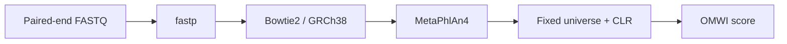

# OMWI: Oral Microbiome Wellness Index

<p align="center">
  
</p>

<p align="center">
  <a href="LICENSE"></a>
  
  
  
  
</p>

<p align="center">
  <a href="#quick-start">Quick start</a> &nbsp;·&nbsp;
  <a href="#usage">Usage</a> &nbsp;·&nbsp;
  <a href="#score-interpretation">Score interpretation</a> &nbsp;·&nbsp;
  <a href="#data-and-reproducibility">Data &amp; reproducibility</a> &nbsp;·&nbsp;
  <a href="#citation">Citation</a>
</p>

## Overview

The **Oral Microbiome Wellness Index (OMWI)** is a disease-agnostic, biologically interpretable score derived from human oral shotgun metagenomic profiles. It quantifies the extent to which an oral microbial community resembles a health-associated reference state.

OMWI uses species-level taxonomic profiles and an elastic-net logistic regression model to generate a continuous score. The repository provides both an OMWI scoring workflow and data and analytical scripts from the study.

> **Research use only.** OMWI is not a clinical diagnostic test and does not predict the presence of any specific disease or directly measure overall clinical wellness.

> **Repository status:** The currently distributed model and study data correspond to the earlier analysis version. Revised study data and model files will be provided together once finalized.

## Quick start

The fastest way to calculate OMWI is to use an existing species-level abundance table. If starting from raw sequencing reads, use the full workflow described below.

```bash
git clone https://github.com/Minjunhoo2001/OMWI.git
cd OMWI
conda env create -f environment.yml
conda activate omwi_env
bash workflow/test_installation.sh
```

The full workflow is intended for Linux or HPC environments. Scoring an existing species-level table requires R and `data.table` and does not require the reference databases.

## Usage

### Option 1. Calculate OMWI from taxonomic profiles

Provide a tab-delimited **species-by-sample** relative abundance table. The first column contains species names; the remaining columns contain sample abundances.

Example input (illustrative format only):

```text
feature	sample01	sample02
Neisseria_subflava	0.012	0.004
Streptococcus_sanguinis	0.003	0.001
Tannerella_forsythia	0.000	0.005
```

Use actual tab characters between columns and provide the full species profile, not just the illustrative species above. Proportion-scale abundances (0–1) are recommended to avoid ambiguity in the current script's automatic unit detection.

```bash
Rscript scripts/calc_omwi.R \
  --input taxonomy_species.tsv \
  --coef models/omwi_species_coefficients.tsv \
  --universe models/omwi_species_universe.tsv \
  --output omwi_scores.tsv
```

<details>
<summary><b>Starting from a merged MetaPhlAn4 profile?</b></summary>

Extract species-level abundances first:

```bash
python scripts/metaphlan_level_extractor.py metaphlan4_merged.tsv level
```

Then use `level/metaphlan4_merged_species.tsv` as the input to the scoring command above.

Use the MetaPhlAn version and marker database specified in the [model configuration](models/model_config.yml). A previously generated merged profile is available in [test_results_env/04.merged/](test_results_env/04.merged/) for inspecting the expected format.

</details>

### Option 2. Calculate OMWI from paired-end FASTQ files

The full workflow performs quality control, human read removal, taxonomic profiling and OMWI calculation.



<details>
<summary><b>Database configuration</b></summary>

The full workflow requires the following external databases, which are not included in this repository:

- A GRCh38 Bowtie2 index for human read removal.
- MetaPhlAn4 marker database: `mpa_vJun23_CHOCOPhlAnSGB_202403`.

```bash
export HOST_INDEX=/path/to/human_bowtie2_index/human_ref
export MPA_DB=/path/to/metaphlan4_database
export MPA_INDEX=mpa_vJun23_CHOCOPhlAnSGB_202403
```

`HOST_INDEX` is the Bowtie2 index prefix (e.g., `/path/to/human_ref` for `/path/to/human_ref.1.bt2`), not the directory containing the index.

</details>

Create a tab-delimited sample sheet named `samples.tsv` with exactly these column names:

```text
sample_id	r1	r2
sample01	/path/to/sample01_R1.fastq.gz	/path/to/sample01_R2.fastq.gz
sample02	/path/to/sample02_R1.fastq.gz	/path/to/sample02_R2.fastq.gz
```

After configuring the databases, run:

```bash
THREADS=8 bash workflow/run_omwi_pipeline.sh samples.tsv results
```

The final score table is written to `results/05.omwi/omwi_scores.tsv`.

<details>
<summary><b>HPC / LSF submission</b></summary>

An example LSF submission script is available at [submit/submit_omwi_test.lsf](submit/submit_omwi_test.lsf). Update the project directory, database paths, sample sheet and output directory before submission.

```bash
bsub < submit/submit_omwi_test.lsf
```

</details>

## Score interpretation

OMWI is the linear predictor of an elastic-net logistic regression model:

```math
\mathrm{OMWI}_i = \beta_0 + \sum_{j \in S} \beta_j\,\mathrm{CLR}(x_{ij})
```

where $S$ is the set of species with non-zero coefficients. CLR transformation uses the complete fixed species universe defined by the released model, including taxa with zero coefficients. Missing universe taxa are filled with zero abundance before the model-specific pseudocount is added.

| OMWI score | Interpretation |
| :--- | :--- |
| `> 0` | More health-associated oral microbial profile |
| `< 0` | More non-healthy-associated oral microbial profile |
| `= 0` | Fitted model probability of 0.5; classification boundary |

These interpretations describe microbiome-associated patterns, not clinical diagnoses or calibrated individual disease risks.

<details>
<summary><b>Output columns</b></summary>

| Column | Description |
| :--- | :--- |
| `sample_id` | Sample identifier |
| `OMWI` | Elastic-net linear predictor |
| `predicted_state` | `health_associated` for scores > 0; otherwise `non_healthy_associated` |
| `matched_universe_taxa` | Number of universe taxa matched in the input table (table-level, not per-sample detection) |
| `total_universe_taxa` | Number of taxa in the fixed CLR universe |

</details>

## Data and reproducibility

The following directories provide the study inputs, model files and available analytical outputs. These links refer to the current repository structure.

| Resource | Description |
| :--- | :--- |
| [Study and sample metadata](data/01.split/) | Training/external metadata and study assignments |
| [Taxonomic profiles](data/02.by_level/) | Microbial abundance matrices across taxonomic ranks |
| [Batch-correction data](data/03.batch_train/) | Earlier analysis version's batch-corrected training and uncorrected external profiles |
| [Model files](models/) | Released coefficients, fixed CLR universe and model configuration |
| [Model development and validation outputs](data/04.elastic/) | Earlier analysis version's tuning, validation and prediction files |
| [Analytical and visualization scripts](scripts/) | Available R and Python scripts |
| [Manuscript results](results/) | Figures, supplementary figures and associated data |

<details>
<summary><b>Model files</b></summary>

| File | Description |
| :--- | :--- |
| [model_config.yml](models/model_config.yml) | Model and preprocessing settings |
| [omwi_species_coefficients.tsv](models/omwi_species_coefficients.tsv) | Intercept and non-zero species coefficients |
| [omwi_species_coefficients_full.tsv](models/omwi_species_coefficients_full.tsv) | Full coefficient table, including zero coefficients |
| [omwi_species_universe.tsv](models/omwi_species_universe.tsv) | Fixed feature space for CLR transformation |
| [omwi_species_model_config.tsv](models/omwi_species_model_config.tsv) | Additional model specification |

The coefficients, species universe and preprocessing settings must be used together as a matched model version.

</details>

## Citation

If you use OMWI in your research, please cite the associated manuscript:

> An oral microbiome wellness index differentiates between healthy and non-healthy states across multiple cohorts.

The complete journal citation and DOI will be added when available.

## License and support

The source code is released under the [MIT License](LICENSE).

For questions, bug reports or suggestions, please use [GitHub Issues](https://github.com/Minjunhoo2001/OMWI/issues).
