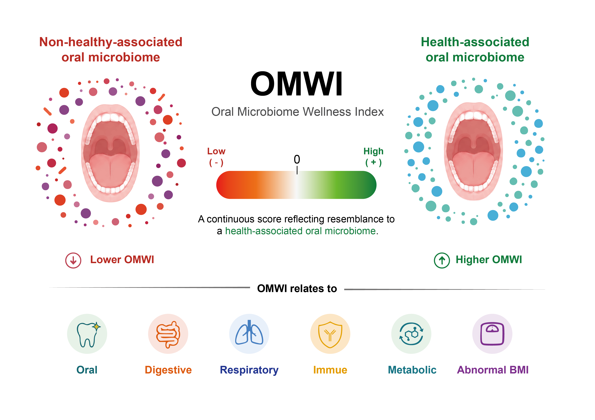
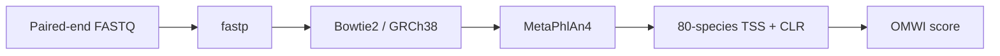

# OMWI: Oral Microbiome Wellness Index

<p align="center">
  
</p>

<p align="center">
  <a href="LICENSE"></a>
  
  
  
</p>

<p align="center">
  <a href="#installation">Installation</a> · <a href="#quick-start">Quick start</a> · <a href="#usage">Usage</a> · <a href="#score-interpretation">Score interpretation</a> · <a href="#data-and-reproducibility">Reproducibility</a> · <a href="#citation">Citation</a>
</p>

## Overview

The **Oral Microbiome Wellness Index (OMWI)** is a continuous, disease-agnostic score that quantifies the extent to which an individual's oral microbiome profile resembles health-associated versus non-healthy-associated microbial patterns. The frozen model uses 80 species-level features (39 positively weighted and 41 negatively weighted) and elastic-net logistic regression. It was developed using 1,077 samples from 17 studies and independently evaluated on 716 samples from 11 studies. No batch correction or model refitting is required for scoring new samples.

The model was developed using saliva, tongue dorsum, pharyngeal swab and oral rinse shotgun metagenomes. Transferability to dental plaque and other oral niches is not established. **For research use only.** OMWI is not a clinical diagnostic test or a calibrated measure of individual disease risk.

## Installation

Clone the repository and run the commands from its root directory:

```bash
git clone https://github.com/Minjunhoo2001/OMWI.git
cd OMWI
```

### Scoring from existing abundance profiles

Only R (R 4.4 recommended; study used R 4.4.3) and `data.table` are required. Install the package in R if needed:

```r
install.packages("data.table", repos = "https://cloud.r-project.org")
```

### Full workflow from FASTQ (Linux/HPC)

Install the optional sequencing tools using Conda:

```bash
conda env create -f environment.yml
conda activate omwi_env
```

The reference databases are not bundled with the repository; see the FASTQ tutorial below. If using the manuscript analysis scripts, install the additional packages listed in [manuscript/README.md](manuscript/README.md).

## Quick start

Test the frozen scoring model using the included synthetic profiles:

```bash
Rscript scripts/test_scoring.R
```

A successful check prints `Synthetic score parity passed.` To generate the scores yourself:

```bash
Rscript scripts/calc_omwi.R \
  --input example/example_species_abundance.tsv \
  --output omwi_scores.tsv
```

Compare the OMWI values with [expected_omwi_scores.tsv](example/expected_omwi_scores.tsv):

| Sample | OMWI (rounded) |
| :--- | ---: |
| synthetic_positive_weighted | 0.124696 |
| synthetic_negative_weighted | -4.698319 |
| synthetic_sparse | -2.472806 |

These are synthetic examples, not clinical samples.

## Usage

### Option 1. Calculate OMWI from species-level abundance profiles

Use MetaPhlAn **4.1.1** with marker database `mpa_vJun23_CHOCOPhlAnSGB_202403`. Provide a tab-delimited species-by-sample table with a header: the first column contains species identifiers, and the remaining columns contain unique sample IDs and nonnegative relative abundances. Use the original, untransformed abundance values, either proportions (0–1) or percentages (0–100), on a consistent scale within each sample. The fixed-panel normalization makes these scales equivalent.

Illustrative input format (only three rows shown; use a complete measured profile in practice):

```text
feature	sample01	sample02
Streptococcus_mitis	0.012	0.004
Neisseria_subflava	0.003	0.001
Fusobacterium_nucleatum	0.000	0.005
```

Use the exact MetaPhlAn species identifiers (including underscores and any species-level SGB identifiers) from [the model panel](models/omwi_species_universe.tsv). Full species-level clade names ending in `s__...` are also accepted. Do not use genus-level profiles, strain-level rows, 16S amplicon profiles, CLR-transformed values, or different taxonomy identifiers as substitutes. Include all detected species; missing panel species are filled with zero. A profile needs measurable panel signal for meaningful biological interpretation.

```bash
Rscript scripts/calc_omwi.R \
  --input taxonomy_species.tsv \
  --coef models/omwi_species_coefficients.tsv \
  --universe models/omwi_species_universe.tsv \
  --output omwi_scores.tsv
```

<details>
<summary><b>Starting from MetaPhlAn4 sample profiles?</b></summary>

Merge the individual profiles (replace the example paths with your files):

```bash
merge_metaphlan_tables.py profiles/*.tsv > metaphlan4_merged.tsv
```

If you already have a merged profile, skip that command. Extract species-level rows (requires Python and `pandas`):

```bash
python scripts/metaphlan_level_extractor.py metaphlan4_merged.tsv level
Rscript scripts/calc_omwi.R \
  --input level/metaphlan4_merged_species.tsv \
  --output omwi_scores.tsv
```

</details>

### Option 2. Calculate OMWI from paired-end FASTQ files

The optional Linux/HPC workflow performs read quality control, human read removal, species profiling and scoring.



**1. Configure external reference databases.** Prepare a GRCh38 Bowtie2 index and install the matching MetaPhlAn4 database. For example, download and build the MetaPhlAn database using its installer:

```bash
metaphlan --install --index mpa_vJun23_CHOCOPhlAnSGB_202403 \
  --bowtie2db /path/to/metaphlan4_database
```

Set these environment variables to your actual paths:

```bash
export HOST_INDEX=/path/to/GRCh38_bowtie2_index/GRCh38
export MPA_DB=/path/to/metaphlan4_database
```

`HOST_INDEX` is the Bowtie2 index prefix, not the directory. `MPA_DB` contains the database files for the exact model database version.

**2. Prepare a sample sheet.** Copy [example/samples.tsv](example/samples.tsv) to `samples.tsv` and edit the paths. Use actual tabs, unique sample IDs, and paired-end FASTQ files:

```text
sample_id	r1	r2
sample01	/path/to/sample01_R1.fastq.gz	/path/to/sample01_R2.fastq.gz
sample02	/path/to/sample02_R1.fastq.gz	/path/to/sample02_R2.fastq.gz
```

**3. Run the workflow.** Use a new output directory for each run:

```bash
THREADS=8 bash workflow/run_omwi_pipeline.sh samples.tsv omwi_run
```

The score table is written to `omwi_run/05.omwi/omwi_scores.tsv`. The paired-end workflow is a convenience preprocessing route; verify sequencing quality, host removal and sufficient microbial reads before interpreting scores. The scoring test above is independent of FASTQ processing.

<details>
<summary><b>HPC / LSF submission</b></summary>

Activate the Conda environment and export the database paths on your cluster login node. Edit [submit/submit_omwi_test.lsf](submit/submit_omwi_test.lsf) as needed, then submit from the repository root:

```bash
bsub < submit/submit_omwi_test.lsf
```

</details>

## Score interpretation

For each sample, let $a_j$ be the original relative abundance of panel species $j$. After aligning the fixed panel and filling absent taxa with zero, the transformation is:

```math
p_j = \frac{a_j}{\sum_{k=1}^{80} a_k},\qquad
z_j = \log(100p_j + 10^{-6}) - \frac{1}{80}\sum_{k=1}^{80}\log(100p_k + 10^{-6})
```

```math
\mathrm{OMWI} = \beta_0 + \sum_{j=1}^{80}\beta_j z_j
```

Both TSS normalization and CLR centering use **only the fixed 80 species**. The pseudocount is added on the percentage scale. The exported coefficients already incorporate the fitted model's scaling; no additional standardization is applied. No model refitting or batch correction is needed. The score is a model-derived linear predictor.

| OMWI | Interpretation |
| :--- | :--- |
| `> 0` | More health-associated oral microbiome profile |
| `< 0` | More non-healthy-associated oral microbiome profile |
| `= 0` | Equal fitted odds; model-derived reference boundary |

The zero cutoff is not a clinically established threshold. An input without detectable panel taxa has no biological panel signal; see [model documentation](models/README.md).

### Output columns

| Column | Description |
| :--- | :--- |
| `sample_id` | Sample identifier |
| `OMWI` | Continuous score (linear predictor) |
| `predicted_state` | `health_associated` if OMWI > 0, otherwise `non_healthy_associated` |
| `matched_universe_taxa` | Number of panel taxa matched across the input table, not per-sample detection |
| `total_universe_taxa` | Total panel size (80) |
| `prob_healthy` | Fitted logistic probability, not calibrated clinical risk |

## Data and reproducibility

| Resource | Description |
| :--- | :--- |
| [models/](models/) | Frozen coefficients (including intercept), panel and model settings |
| [scripts/](scripts/) | OMWI scoring, taxonomic extraction and scoring tests |
| [example/](example/) | Synthetic example profiles, expected scores and FASTQ sample sheet template |
| [workflow/](workflow/) | Optional sequencing workflow and installation test |
| [manuscript/](manuscript/) | Study input data and available analysis scripts; see [reproducibility instructions](manuscript/README.md) for inputs and coverage |

For checking scores against the included study predictions (no refitting):

```bash
(cd manuscript && unzip -n data.zip)
Rscript scripts/test_real_sample_parity.R
```

The independent validation predictions are generated by applying the frozen scoring model, without using external outcomes for model fitting. The manuscript analysis directory describes which additional inputs are needed for other analyses. The scoring workflow does not require these files.

## Citation

If you use OMWI, please cite the associated manuscript:

> An oral microbiome wellness index differentiates healthy from non-healthy states across multiple cohorts.

Publication details and DOI will be added when available.

## License and support

The source code is distributed under the [MIT License](LICENSE). For questions, bug reports or suggestions, use [GitHub Issues](https://github.com/Minjunhoo2001/OMWI/issues).
